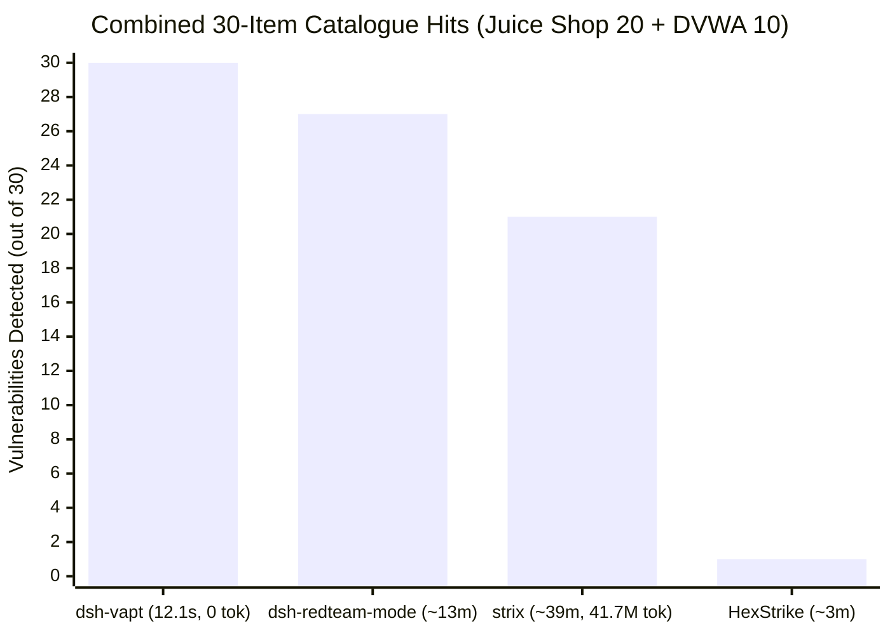
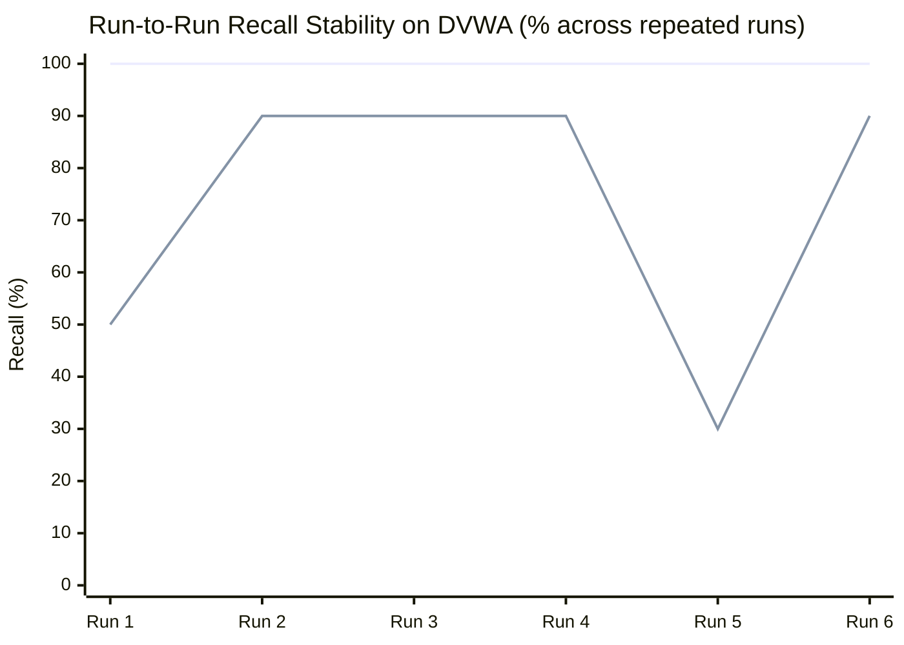
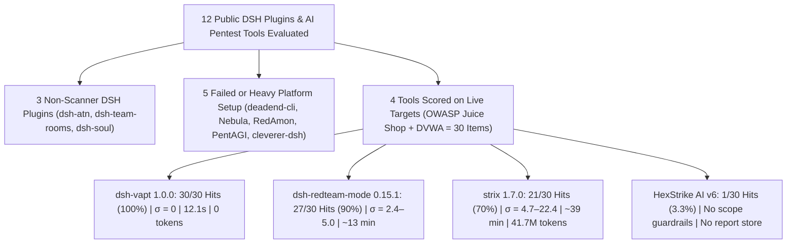

# dsh-vapt

**English** · [中文](README.zh.md)

`dsh-vapt` keeps a local record of an authorized security assessment in DeepSeek Harness (DSH). Each engagement has its own scope, assets, findings, and evidence. The plugin renders Chinese and English Markdown reports and a JSON export from those records.

## Sample report

The sample report is generated from a fictional "Paper Boat Archive" asset inventory. Below is an excerpt of a finding from evidence to remediation:

| Finding | Evidence excerpt | Remediation |
|---|---|---|
| Asset inventory is missing a maintenance owner (Low) | `{"asset":"archive.example.invalid","owner":null}` | Record the responsible team and contact channel, and have on-call staff verify that the team can be reached. |

The fictional archive’s inventory has no owner for its catalogue service. The Markdown export links the finding to its evidence and includes a concrete fix. [Read the sample report (English)](docs/example-report.en.md) · [查看中文报告示例](docs/example-report.zh.md)

## Install from source

From the project root, use Node.js 22, npm, and your local DSH CLI to pack the checkout and install it into the `pentest` profile. The installer creates the profile from DSH’s web template if needed and registers the plugin. Set `DSH_BIN` to the CLI’s absolute path if `dsh` is unavailable on your PATH. The package declares Node.js 20 or later and lists DSH `0.2.2-rc.3` and `0.2.2-rc.5` as host targets.

```sh
npm pack
node bin/dsh-vapt.mjs install --profile pentest --package "$PWD/dsh-vapt-1.0.0.tgz"
"${DSH_BIN:-dsh}" --profile pentest
```

On first launch, open the mode picker in a new session. The plugin adds one entry by default, **VAPT mode**, which covers the engagement from record creation through evidence collection and reporting. To check registration, run the following from the project root in a second terminal:

```sh
node bin/dsh-vapt.mjs doctor
```

### Optional modes

| Preset ID | Menu label |
|---|---|
| `vapt-recon` | VAPT recon mode |
| `vapt-verify` | VAPT verify mode |
| `vapt-report` | VAPT report mode |

Edit `profiles/pentest/cordis.patch.yml` under `DSH_HOME` (default `~/.dsh/profiles/pentest/cordis.patch.yml`). Add the required preset IDs to the `optionalPresets` list under the `dsh-vapt` entry, then restart the profile to apply the change. The example below enables the report mode alongside the default, so the menu shows **VAPT mode** and **VAPT report mode**:

```yaml
- id: dsh-vapt
  name: dsh-vapt
  config:
    optionalPresets: [vapt-report]
```

List any combination of the three IDs. Set `optionalPresets: []` and restart to return to a single **VAPT mode** entry.

## From records to reports

| Task | Tool | Result |
|---|---|---|
| Start a record | `vapt_engagement_open` | Creates the engagement, saves its client name, scope, exclusions, and test window, and returns its ID. |
| Record observations | `vapt_asset_add`, `vapt_finding_add`, `vapt_evidence_add` | Records assets and findings, links evidence to a finding by ID, and records a SHA-256 digest for the evidence. |
| Review findings | `vapt_status`, `vapt_findings_list` | Compares total findings against deliverable findings and shows the status of each record. |
| Export reports | `vapt_report` | Writes `report.zh.md`, `report.en.md`, and `report.json` in the engagement directory. |

In **VAPT mode**, open a new engagement with `vapt_engagement_open`, or check an existing engagement’s ID with `vapt_status` and generate the files with `vapt_report`. Because multiple sessions share a current-engagement pointer, pass the `engagement` ID explicitly when sessions share a store and work on different assessments.

**Which findings appear in the report?** A finding qualifies when its `status` is `confirmed` or `exploited` and its `confidence` is other than `claimed`. Attached evidence is optional, though linked evidence should be reviewed before delivery. In `report.json` (schema `dsh-vapt/report@1`), `counts.findings` is the number included and `counts.withheld` is the number left out.

**How do I verify an evidence digest?** Join the original `tool`, `command`, `request`, and `response` fields in that order with a single line feed (`LF`), and compute SHA-256 over the UTF-8 bytes. The store retains the first 20,000 UTF-16 code units of each request and response, while Markdown shows up to 2,000 code units of the response. Keep the full original inputs if you need to verify a truncated record.

## Console and integrations

- **DSH** · The plugin registers 17 DSH tools and adds **VAPT mode** to the mode picker by default. Click the `vapt` button next to the chat input (or open the local `/vapt/ui` page) to inspect engagements, review findings, and preview reports.
- **MCP** · `dsh-vapt-mcp` exposes 14 local record and report tools over stdio for managing engagements, assets, findings, and evidence, as well as exporting reports. Set `VAPT_ENGAGEMENT` to select an existing record by ID.
- **External tools** · The registry describes 145 external tools (binaries must be installed separately). Recording findings and generating reports only require the local store.

## Storage and privacy

The DSH plugin’s `root` setting and the MCP server’s `VAPT_ROOT` environment variable each take precedence for their respective client. When unset, both fall back to `VAPT_HOME`, `$DSH_HOME/vapt`, or `~/.dsh/vapt` (if `DSH_HOME` is unset). Point both clients at the same directory to read and write shared records.

```text
<data-root>/
  current.json
  engagements/<engagement-id>/
    engagement.json
    assets.json        findings.json      evidence.json
    credentials.json   events.jsonl       artifacts/
    report.zh.md       report.en.md       report.json
```

`credentials.json` stores credential secrets in plaintext locally. Newly created or rewritten credential files and report exports use file mode `0600` on POSIX systems (macOS/Linux). The console's evidence preview displays only metadata and SHA-256 digests. Disk exports omit the credential secret field, but can contain recorded commands and, in Markdown exports, raw requests and responses. Review exports for sensitive information before sharing them. [Security policy](SECURITY.md)

## Local checks

Run these checks from the project root without starting DSH or Docker. They use local fixtures, temporary stores, or package metadata.

| Command | Coverage |
|---|---|
| `npm run mcp:test` | Verifies the 14-tool MCP inventory, stdio handshake, findings, evidence digests, credential masking, project isolation, and all three exports using fictional assets. |
| `npm run test:privacy` | Checks file permissions, path boundaries, corrupted table recovery, scope exclusions, dashboard redaction, and Markdown rendering. |
| `npm run client:test` | Verifies the console dock button registration, refresh, and report preview. |
| `npm run host:check` | Checks the DSH client manifest and loader entry point. |
| `npm run stress` | Tests concurrent store writes, stale locks, and fault recovery. |
| `npm run bench:test` | Verifies benchmark scoring arithmetic and repeatable summaries. |

With the local DSH CLI installed, run `npm run check:install`. It repacks the current source, creates a profile in an isolated temporary `DSH_HOME`, and verifies that only `VAPT mode` is registered by default.

The full test entry point is `npm test`, which also runs functional checks and a benchmark against a local synthetic target fixture. [Package scripts](package.json)

## Benchmark vs. market plugins & agents

We evaluated 12 public DSH plugins and AI pentest tools against the same frozen vulnerability catalogue (**v1.6.2**: 20 items + 2 negative controls on OWASP Juice Shop; 10 items on authenticated DVWA) under identical scoring rules. Four tools produced scorable vulnerability findings on the live targets (`dsh-redteam-mode` and `strix` were both driven by `deepseek/deepseek-chat`).

### 1. Detection, speed, and cost (best adjudicated run)



| Target | Tool | Visual recall | Recall | F1 | Hits | FP | Time | Cost |
|---|---|---|---:|---:|---:|---:|---:|---|
| **OWASP Juice Shop** (20) | **dsh-vapt** (deterministic probes) | `████████████████████` | **100.0%** | **100.0%** | **20 / 20** | 0 | **3.4 s** | **0 tokens** |
| OWASP Juice Shop (20) | dsh-redteam-mode `0.15.1` | `█████████████████░░░` | 85.0% | 91.9% | 17 / 20 | 0 | ~5 min | DeepSeek API |
| OWASP Juice Shop (20) | strix `1.7.0` | `████████████░░░░░░░░` | 60.0% | 75.0% | 12 / 20 | 0 | ~35 min | 23.78M tokens (~$2.00) |
| OWASP Juice Shop (20) | HexStrike AI `v6` (nuclei backend) | `█░░░░░░░░░░░░░░░░░░░` | 5.0% | 9.5% | 1 / 20 | 0 | ~2 min | 0 tokens |
| **DVWA** (10) | **dsh-vapt** (deterministic probes) | `████████████████████` | **100.0%** | **100.0%** | **10 / 10** | 0 | **8.7 s** | **0 tokens** |
| DVWA (10) | dsh-redteam-mode `0.15.1` | `████████████████████` | 100.0% | 100.0% | 10 / 10 | 0 | ~8 min | DeepSeek API |
| DVWA (10) | strix `1.7.0` | `██████████████████░░` | 90.0% | 94.7% | 9 / 10 | 0 | 4.4 min | 17.96M tokens (~$1.50) |
| DVWA (10) | HexStrike AI `v6` (nuclei backend) | `░░░░░░░░░░░░░░░░░░░░` | 0.0% | 0.0% | 0 / 10 | 0 | ~1 min | 0 tokens |

### 2. Run-to-run repeatability (same model, prompt, and target)

LLM agents exhibit significant run-to-run variance on the exact same target and prompt—and often miss configuration or exposure issues (`/metrics`, `/support/logs`, `/ftp` directory listing, missing security headers, exposed `setup.php`)—whereas `dsh-vapt`'s deterministic probes achieve zero variance (`σ = 0`):


> **Top line (`100%` flat):** `dsh-vapt` (`σ = 0.0`) · **Bottom line (`30%–90%` swing):** `strix` (`σ = 22.4`)

| Target | Tool | Per-round recall (%) | Mean | Std dev (`σ`) | Runs (`n`) |
|---|---|---|---:|---:|---:|
| **DVWA** (10) | **dsh-vapt** | `100 / 100 / 100` | **100.0%** | **0.0** | 3 |
| DVWA (10) | dsh-redteam-mode | `100 / 90` (+1 timeout at 420 s) | 95.0% | 5.0 | 2 |
| DVWA (10) | strix | `50 / 90 / 90 / 90 / 30 / 90` | 73.3% | 22.4 | 6 |
| **OWASP Juice Shop** (20) | **dsh-vapt** | `100 / 100 / 100` | **100.0%** | **0.0** | 3 |
| OWASP Juice Shop (20) | dsh-redteam-mode | `85 / 85 / 80` | 83.3% | 2.4 | 3 |
| OWASP Juice Shop (20) | strix | `50 / 50 / 40` | 46.7% | 4.7 | 3 |

### 3. Ecosystem comparison (12 tools evaluated)



| Tool | Type | Install & boot | Guardrails (scope / budget / allowlist) | Evidence & reporting | Benchmark status |
|---|---|---|---|---|---|
| **dsh-vapt `1.0.0`** | DSH plugin + MCP | ✅ Clean (1 default + 3 role presets) | ✅ Hard scope check, arg allowlist, spray lockout stop, role tool filtering | ✅ JSON store + SHA-256 digests + zh/en Markdown & Mermaid + `report.json` | **30 / 30** across both targets (`σ = 0`) |
| **dsh-redteam-mode `0.15.1`** | DSH plugin | ✅ Clean | Not enforced at tool layer | SQLite store + report | **27 / 30** best run (5–8 min/run) |
| **strix `1.7.0`** | CLI agent | ⚠️ Needs Python ≥3.12 & Docker sandbox | `--max-budget` / `--max-turns` | Run directory + report | **21 / 30** best run (41.7M tokens total) |
| **HexStrike AI `v6`** | HTTP/MCP backend | ⚠️ Broken `requirements.txt` (`unicorn`) | ❌ None (unauthenticated `/api/command` runs out-of-scope shell) | ❌ No findings store or reports | **1 / 30** via nuclei endpoint |
| **dsh-atn `0.7.0`** | DSH plugin | ✅ Clean | — | Topology visualizer (not a scanner) | Not a vulnerability detector |
| **dsh-team-rooms `1.0.9`** | DSH plugin | ✅ Clean | — | Cross-session collaboration rooms | Not a vulnerability detector |
| **dsh-soul `0.14.0`** | DSH plugin | ✅ Clean | — | Correction / memory plugin | Not a vulnerability detector |
| **deadend-cli `0.1.15`** | CLI agent | ❌ Crashes on start (`ImportError`) | — | — | Failed to boot |
| **Nebula `2.0.0`** | CLI workbench | ⚠️ `--help` hangs >60 s | — | — | Timed out on init |
| **RedAmon / PentAGI / cleverer-dsh** | Platforms / unlisted | ⚠️ Multi-hour image build, 12-service EULA, or not on npm | — | — | `not-run` (see details) |

> **Scope note:** Deterministic probes guarantee fast, zero-token, 100% repeatable baseline coverage on known catalogue classes, while LLM agents remain useful for open-ended, multi-step business logic exploration outside a predefined catalogue.

[Full paper benchmark & item-by-item matrix](bench/PAPER.md) · [Competitor evaluation notes](bench/COMPETITORS.md) · [Recorded results JSON](bench/paper-results.json) · [Methodology](bench/METHODOLOGY.md)

[Architecture](docs/ARCHITECTURE.md) · [Changelog](CHANGELOG.md) · [Apache-2.0 license](LICENSE)
