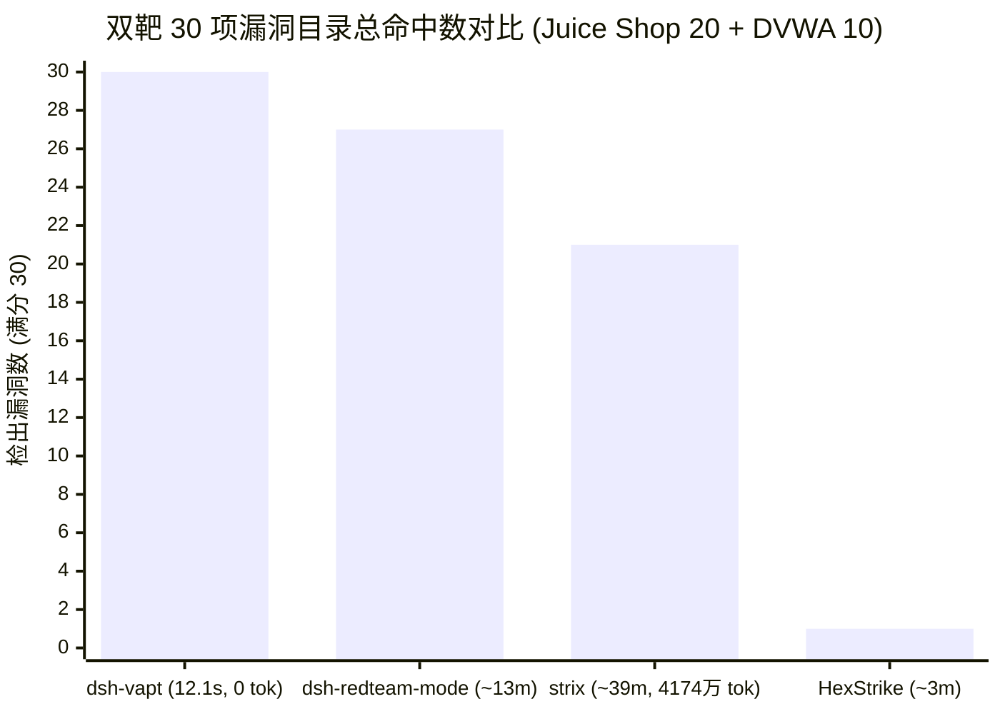
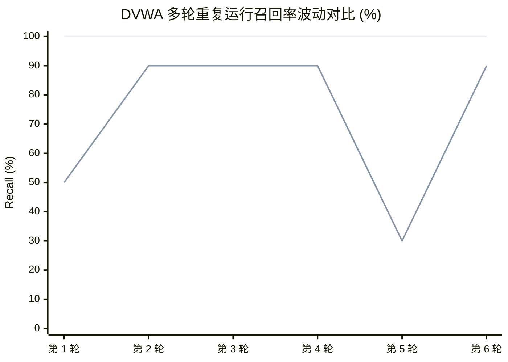
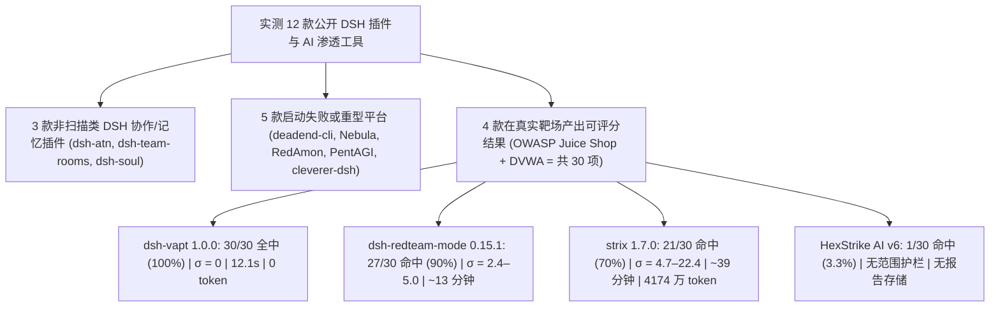

# dsh-vapt

[English](README.md) · **中文**

`dsh-vapt` 是 DeepSeek Harness（DSH）的本地渗透测试记录插件。每个授权项目独立保存范围、资产、发现和证据，同一份记录可以生成中英文 Markdown 报告和 JSON 交付件。

## 报告示例

这份中文报告用虚构的「纸舟档案馆」资产清单生成。下面是一条发现从证据到修复建议的摘录：

| 发现 | 证据摘录 | 修复建议 |
|---|---|---|
| 资产清单缺少维护负责人（低风险） | `{"asset":"archive.example.invalid","owner":null}` | 填写负责团队和联系渠道，由值班人员验证能否联系到该团队。 |

该虚构档案馆的目录服务在资产清单中没有填写负责人。导出的 Markdown 报告将发现与证据关联，并给出了具体的修复方案。[查看中文报告示例](docs/example-report.zh.md) · [Read the sample report (English)](docs/example-report.en.md)

## 从源码安装

使用 Node.js 22、npm 和本机 DSH CLI，在项目根目录执行以下命令打包并安装到 `pentest` profile。安装程序会按需从 DSH 的 web 模板创建配置并注册插件。若 `dsh` 不在 PATH 中，请将 `DSH_BIN` 设为 CLI 的绝对路径。本包声明支持 Node.js 20 及以上版本，宿主目标版本为 DSH `0.2.2-rc.3` 和 `0.2.2-rc.5`。

```sh
npm pack
node bin/dsh-vapt.mjs install --profile pentest --package "$PWD/dsh-vapt-1.0.0.tgz"
"${DSH_BIN:-dsh}" --profile pentest
```

首次启动后，打开新会话的模式菜单。插件默认只添加 **VAPT mode**，建档、整理证据和导出报告都可在这里完成。在另一个终端，从项目根目录运行以下命令可检查注册状态：

```sh
node bin/dsh-vapt.mjs doctor
```

### 选配模式

| 配置 ID | 菜单名称 |
|---|---|
| `vapt-recon` | VAPT recon mode |
| `vapt-verify` | VAPT verify mode |
| `vapt-report` | VAPT report mode |

在 `DSH_HOME` 下的 `profiles/pentest/cordis.patch.yml`（默认位于 `~/.dsh/profiles/pentest/cordis.patch.yml`）中，把需要的 ID 加入 `dsh-vapt` 的 `optionalPresets` 列表。下例只选配报告模式，重启该 profile 后，菜单会显示 **VAPT mode** 和 **VAPT report mode**：

```yaml
- id: dsh-vapt
  name: dsh-vapt
  config:
    optionalPresets: [vapt-report]
```

每个 ID 都可单独选用，也可任意组合。设为 `optionalPresets: []` 并重启即可恢复只显示一个 **VAPT mode** 的默认状态。

## 从记录到报告

| 操作 | 工具 | 结果 |
|---|---|---|
| 建立项目 | `vapt_engagement_open` | 创建项目并返回 ID，保存客户名、范围、排除项和测试窗口。 |
| 整理记录 | `vapt_asset_add`, `vapt_finding_add`, `vapt_evidence_add` | 记录资产和发现，通过 finding ID 关联证据，并计算证据的 SHA-256 摘要。 |
| 核对发现 | `vapt_status`, `vapt_findings_list` | 对照发现总数与可交付数量，查看每条记录的状态。 |
| 导出报告 | `vapt_report` | 在项目目录中生成 `report.zh.md`、`report.en.md` 和 `report.json`。 |

在 **VAPT mode** 中使用 `vapt_engagement_open` 建档。对已有项目，先用 `vapt_status` 核对 ID，再用 `vapt_report` 导出。多个会话共用同一个当前项目指针，同时处理不同项目时请显式传入 `engagement` ID。

**哪些发现会进入报告？** 发现的 `status` 必须是 `confirmed` 或 `exploited`，且 `confidence` 不能是 `claimed`。证据附件是可选项，交付前应核对关联证据。在 `report.json`（schema `dsh-vapt/report@1`）中，`counts.findings` 表示纳入报告的数量，`counts.withheld` 表示未纳入的数量。

**如何核对证据摘要？** 按顺序将原始 `tool`、`command`、`request`、`response` 用一个换行符（`LF`）连接，再对 UTF-8 字节计算 SHA-256。数据存储会保留每个请求和响应的前 20,000 个 UTF-16 码元，Markdown 报告最多显示响应的前 2,000 个码元。较长的记录会被截短，核对时需要保留完整原文。

## 控制台与接口

- **DSH** · 插件提供 17 个 DSH 工具。新 profile 的模式菜单默认只添加 **VAPT mode**。点击输入框旁的 `vapt` 按钮（或打开本地 `/vapt/ui` 页面）可查看项目、审核发现和预览报告。
- **MCP** · `dsh-vapt-mcp` 通过标准输入输出（stdio）提供 14 个本地记录和报告工具，可整理项目、资产、发现和证据，并导出报告。设置环境变量 `VAPT_ENGAGEMENT` 可按 ID 指定已有项目。
- **外部工具** · 注册表包含 145 个外部工具条目，对应程序需另行安装。记录发现和生成报告只需使用本地存储。

## 数据位置与隐私

DSH 优先使用插件配置中的 `root`，MCP 优先使用环境变量 `VAPT_ROOT`。缺省时，两者依次回退到 `VAPT_HOME`、`$DSH_HOME/vapt` 或 `~/.dsh/vapt`（未设置 `DSH_HOME` 时）。将两个客户端指向同一目录即可共享和读写项目记录。

```text
<data-root>/
  current.json
  engagements/<engagement-id>/
    engagement.json
    assets.json        findings.json      evidence.json
    credentials.json   events.jsonl       artifacts/
    report.zh.md       report.en.md       report.json
```

`credentials.json` 在本地以明文保存凭据。新建或重写的凭据文件和导出报告在 POSIX 系统（macOS/Linux）上使用文件权限 `0600`。控制台的证据预览只显示元数据和 SHA-256 摘要。落盘导出的报告会省略凭据密码字段，但可能包含已记录的命令，且本地 Markdown 导出会包含原始请求和响应片段，分享前请检查其中的敏感信息。[安全策略](SECURITY.md)

## 本地检查

以下检查可在源码目录直接运行，无需启动 DSH 或 Docker（使用本地夹具、临时存储或包元数据）：

| 命令 | 检查内容 |
|---|---|
| `npm run mcp:test` | 核对 14 个 MCP 工具、stdio 握手、发现记录、证据摘要、凭据脱敏、项目隔离，并用虚构资产验证全部三种格式的导出流程。 |
| `npm run test:privacy` | 文件权限、目录边界、损坏表恢复、范围排除、控制台预览脱敏与 Markdown 报告渲染格式。 |
| `npm run client:test` | 控制台按钮注册、刷新和报告预览。 |
| `npm run host:check` | DSH 客户端声明及加载器入口。 |
| `npm run stress` | 并发写入、陈旧锁清理和故障恢复。 |
| `npm run bench:test` | 评分计算与结果汇总一致性。 |

已安装本机 DSH CLI 时，可运行 `npm run check:install`。它会重新打包当前源码，在独立的临时 `DSH_HOME` 中创建新 profile，并检查默认只注册 `VAPT mode`。

完整测试入口为 `npm test`，另含功能测试及针对本地合成靶场的基准测试。[脚本定义](package.json)

## 基准实测与市面插件对比

我们在同一冻结漏洞目录（**v1.6.2**：OWASP Juice Shop 20 项 + 2 项负向对照；DVWA 登录态 10 项）和相同评分规则下，实测了 12 款公开的 DSH 插件与 AI 渗透测试工具。其中 4 款工具能在靶场上产出可评分的漏洞发现（`dsh-redteam-mode` 与 `strix` 均使用同一 `deepseek/deepseek-chat` 模型驱动）。

### 1. 检出率、耗时与成本对比（最佳裁决轮次）



| 靶场 | 工具 | 可视化召回率 | 召回率 | F1 | 目录命中 | 误报 | 耗时 | 成本 |
|---|---|---|---:|---:|---:|---:|---:|---|
| **OWASP Juice Shop** (20) | **dsh-vapt**（确定性探针） | `████████████████████` | **100.0%** | **100.0%** | **20 / 20** | 0 | **3.4 s** | **0 token** |
| OWASP Juice Shop (20) | dsh-redteam-mode `0.15.1` | `█████████████████░░░` | 85.0% | 91.9% | 17 / 20 | 0 | ~5 min | DeepSeek API |
| OWASP Juice Shop (20) | strix `1.7.0` | `████████████░░░░░░░░` | 60.0% | 75.0% | 12 / 20 | 0 | ~35 min | 2378 万 token (~$2.00) |
| OWASP Juice Shop (20) | HexStrike AI `v6` (nuclei 后端) | `█░░░░░░░░░░░░░░░░░░░` | 5.0% | 9.5% | 1 / 20 | 0 | ~2 min | 0 token |
| **DVWA** (10) | **dsh-vapt**（确定性探针） | `████████████████████` | **100.0%** | **100.0%** | **10 / 10** | 0 | **8.7 s** | **0 token** |
| DVWA (10) | dsh-redteam-mode `0.15.1` | `████████████████████` | 100.0% | 100.0% | 10 / 10 | 0 | ~8 min | DeepSeek API |
| DVWA (10) | strix `1.7.0` | `██████████████████░░` | 90.0% | 94.7% | 9 / 10 | 0 | 4.4 min | 1796 万 token (~$1.50) |
| DVWA (10) | HexStrike AI `v6` (nuclei 后端) | `░░░░░░░░░░░░░░░░░░░░` | 0.0% | 0.0% | 0 / 10 | 0 | ~1 min | 0 token |

### 2. 多轮重复运行的稳定性（同一模型、同一提示词、同一靶场）

在相同模型和提示词下，LLM 代理多次运行的召回率波动较大，且容易漏报配置与暴露类问题（如 `/metrics`、`/support/logs`、`/ftp` 目录列表、缺失安全响应头、`setup.php` 暴露）；而 `dsh-vapt` 的确定性探针实现了零方差（`σ = 0`）：


> **上方水平线（稳定 `100%`）：** `dsh-vapt` (`σ = 0.0`) · **下方折线（`30%–90%` 大幅波动）：** `strix` (`σ = 22.4`)

| 靶场 | 工具 | 逐轮 Recall (%) | 均值 (Mean) | 标准差 (`σ`) | 轮数 (`n`) |
|---|---|---|---:|---:|---:|
| **DVWA** (10) | **dsh-vapt** | `100 / 100 / 100` | **100.0%** | **0.0** | 3 |
| DVWA (10) | dsh-redteam-mode | `100 / 90`（另 1 次 420s 超时） | 95.0% | 5.0 | 2 |
| DVWA (10) | strix | `50 / 90 / 90 / 90 / 30 / 90` | 73.3% | 22.4 | 6 |
| **OWASP Juice Shop** (20) | **dsh-vapt** | `100 / 100 / 100` | **100.0%** | **0.0** | 3 |
| OWASP Juice Shop (20) | dsh-redteam-mode | `85 / 85 / 80` | 83.3% | 2.4 | 3 |
| OWASP Juice Shop (20) | strix | `50 / 50 / 40` | 46.7% | 4.7 | 3 |

### 3. 市面 12 款工具生态与护栏对比



| 工具 | 形态 | 安装与启动 | 代码级护栏（范围 / 预算 / 白名单） | 证据链与报告 | 实测状态 |
|---|---|---|---|---|---|
| **dsh-vapt `1.0.0`** | DSH 插件 + MCP | ✅ 正常（默认 1 模式 + 3 选配角色） | ✅ 强制范围校验、参数白名单、喷雾锁定即停、角色工具白名单 | ✅ 纯 JSON 库 + SHA-256 摘要 + 中英报告/攻击路径图 + `report.json` | 双靶 **30 / 30** 全中 (`σ = 0`) |
| **dsh-redteam-mode `0.15.1`** | DSH 插件 | ✅ 正常 | 工具层未强制 | SQLite 事实库 + 报告 | 最佳轮次 **27 / 30**（5–8 分钟/轮） |
| **strix `1.7.0`** | CLI 代理 | ⚠️ 需 Python ≥3.12 并拉取 Docker 沙箱 | `--max-budget` / `--max-turns` | 运行目录 + 报告 | 最佳轮次 **21 / 30**（共耗 4174 万 token） |
| **HexStrike AI `v6`** | HTTP/MCP 工具后端 | ⚠️ `requirements.txt` 构建失败（`unicorn`） | ❌ 无（无鉴权、无范围校验，`/api/command` 可越界执行任意 shell） | ❌ 无 findings 库、无报告 | 仅 nuclei 端点命中 **1 / 30** |
| **dsh-atn `0.7.0`** | DSH 插件 | ✅ 正常 | — | 拓扑可视化（非漏洞检测器） | 不产出漏洞发现 |
| **dsh-team-rooms `1.0.9`** | DSH 插件 | ✅ 正常 | — | 跨会话协作房间 | 不产出漏洞发现 |
| **dsh-soul `0.14.0`** | DSH 插件 | ✅ 正常 | — | 修正与失败记忆插件 | 不产出漏洞发现 |
| **deadend-cli `0.1.15`** | CLI 代理 | ❌ 启动即崩溃（SDK `ImportError`） | — | — | 无法启动 |
| **Nebula `2.0.0`** | CLI 工作台 | ⚠️ `--help` 超过 60 秒无响应 | — | — | 初始化超时 |
| **RedAmon / PentAGI / cleverer-dsh** | 平台 / 未发布包 | ⚠️ 需数小时构建 6 镜像、12 服务交互式 EULA，或未发 npm | — | — | `not-run`（详见竞品记录） |

> **适用边界说明**：确定性探针能在几秒内以 0 token、100% 可复现的方式完成已知漏洞目录的基线覆盖；而针对目录外的多步复杂业务逻辑探索，仍可搭配 LLM 代理互补使用。

[完整评测报告与逐项命中矩阵](bench/PAPER.md) · [12 款竞品实测记录](bench/COMPETITORS.md) · [原始评分 JSON](bench/paper-results.json) · [评测方法论](bench/METHODOLOGY.md)

[架构](docs/ARCHITECTURE.md) · [变更记录](CHANGELOG.md) · [Apache-2.0 许可证](LICENSE)
