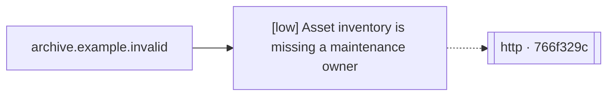

# Penetration Test Report

- **Client**: Paper Boat Archive (fictional example)
- **Engagement**: paper-boat-archive-example-20261122-55a9
- **Authorized scope**: archive.example.invalid
- **Excluded**: -
- **Test window**: 2026-11-22
- **Generated**: 2026-11-22T14:52:04.126Z

## Summary

- Total findings: **1**
- By severity: low=1
- Assets: 1

## Attack path



### Assets

| host | ports |
|---|---|
| archive.example.invalid | - |

## 1. [LOW] Asset inventory is missing a maintenance owner

Asset: archive.example.invalid · Severity: low · Status: confirmed · Confidence: observed


In the asset record for the archive catalogue service, the `owner` field is null. When an incident occurs, on-call staff cannot identify the responsible team from the inventory.

### Remediation

Record the responsible team and contact channel in the asset inventory, and have on-call staff complete a contact drill using this entry.

### Evidence

- **SHA-256**: `766f329cd3c7b3d1f711d334f85f14e892c87ca3cbbbfe4c1b9e5d3dbf69b470`
- **Raw response**:
```http
HTTP/1.1 200 OK
Content-Type: application/json

{"asset":"archive.example.invalid","owner":null}
```

---
> The findings come from recorded engagement data. Before delivery, verify the reported scope against the engagement authorization.
