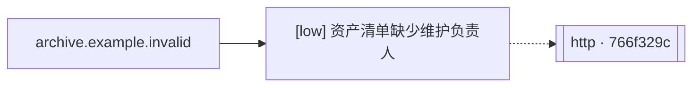

# 渗透测试报告

- **客户**: 纸舟档案馆（虚构示例）
- **靶 ID**: 纸舟档案馆-虚构示例-20261122-55a9
- **授权范围**: archive.example.invalid
- **排除**: -
- **测试窗口**: 2026-11-22
- **产出时间**: 2026-11-22T14:52:04.126Z

## 摘要

- 发现总数: **1**
- 按严重级别: low=1
- 资产: 1

## 攻击路径



### 资产

| host | ports |
|---|---|
| archive.example.invalid | - |

## 1. [LOW] 资产清单缺少维护负责人

资产：archive.example.invalid · 严重级别：low · 状态：confirmed · 信心：observed


档案目录服务的资产记录中，owner 字段为空。值班人员遇到故障时，无法从清单找到负责团队。

### 修复建议

在资产清单中填写负责团队和联系渠道，由值班人员按这条记录完成一次联络演练。

### 证据

- **SHA-256**: `766f329cd3c7b3d1f711d334f85f14e892c87ca3cbbbfe4c1b9e5d3dbf69b470`
- **原始响应**:
```http
HTTP/1.1 200 OK
Content-Type: application/json

{"asset":"archive.example.invalid","owner":null}
```

---
> 本报告的发现来自项目记录。交付前，请核对报告所列范围与项目授权文件是否一致。
